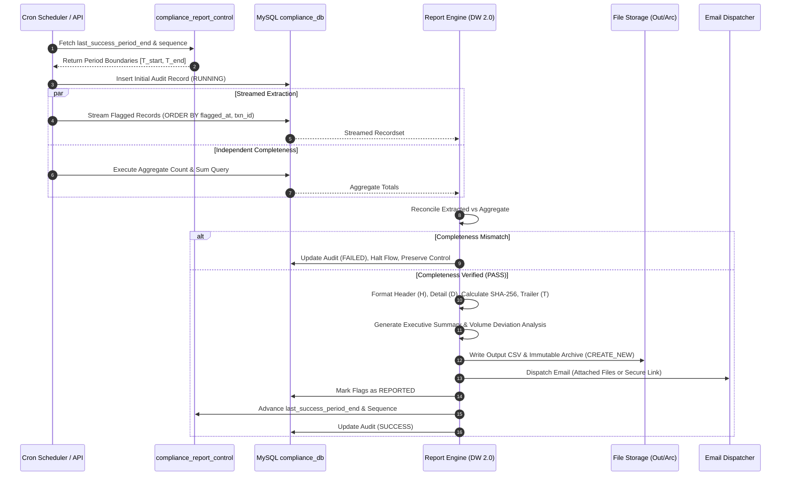

# High Level Design: Regulatory Compliance Reporting (AML/STR)

## 1. Executive Summary & Purpose
The **Regulatory Compliance Reporting Engine** is an enterprise-grade MuleSoft 4.12.2 integration application engineered for financial institutions to automate the extraction, independent validation, cryptographic hashing, immutable archival, and compliance officer dispatch of Suspicious Transaction Reports (STR) and Anti-Money Laundering (AML) regulatory submissions.

Built strictly in accordance with **Use Case 12: Compliance — Regulatory Compliance Reporting**, the system implements a fail-safe, auditable state machine supporting both automated scheduled runs and REST-driven historical reprocessing.

---

## 2. Business Objectives & Core Principles

| Principle | Architectural Implementation |
| :--- | :--- |
| **Contiguous Reporting** | Control table `compliance_report_control` strictly enforces `flagged_at >= periodStart AND flagged_at < periodEnd` without gaps or overlaps. |
| **Fail-Safe Integrity** | Independent aggregate SQL query executes concurrently; any count/amount discrepancy halts the flow before file generation or notification. |
| **Cryptographic Tamper-Evidence** | Canonical SHA-256 hash computed over detail records and embedded directly in Trailer (`T`) line, audit database, and notification emails. |
| **Immutable Archival** | Archived reports are written with `mode="CREATE_NEW"` to prevent overwriting historical regulatory submissions. Reprocessing creates distinct revisions. |
| **Auditable State Machine** | Every execution transitions through granular states: `RUNNING` $\rightarrow$ `REPORT_GENERATED` $\rightarrow$ `ARCHIVED` $\rightarrow$ `NOTIFIED` $\rightarrow$ `SUCCESS` / `FAILED`. |
| **Volume Anomaly Detection** | Trailing 30-day baseline comparison detects and flags volume deviations exceeding configured percentage thresholds ($\pm 50\%$). |
| **Intelligent Notification Routing** | Automatically routes compliance packages via SMTP attachments when under 10MB or generates secure portal download links when oversized. |

---

## 3. High-Level Process Flow

---

## 4. Key Actors and Component Responsibilities

1. **Main Orchestrator (`compliance-main.xml`)**: Manages the complete transactional lifecycle and state transitions.
2. **Database Connector Subflows (`database-subflows.xml`)**: Executes parameter-driven SQL queries, streamed extraction with configurable `fetchSize`, aggregate completeness queries, and audit updates.
3. **DataWeave Transformation Engine (`report-subflows.xml`)**: Renders pipe-delimited records (`H`, `D`, `T`), computes cryptographic SHA-256 hashes, generates human-readable executive summaries, and performs trailing average volume analysis.
4. **Archival & File System Handler (`file-subflows.xml`)**: Generates collision-safe filenames, writes output CSVs, creates immutable archive copies, and calculates byte payloads.
5. **Notification Subflows (`notification-subflows.xml`)**: Renders styled HTML compliance alerts with flag breakdowns, handles attachment size thresholds, and delivers emails via SMTP with bounded retries.
6. **Reprocessing REST API (`compliance-api.xml`)**: Exposes RAML 1.0 compliant endpoints for manual on-demand execution, historical period reruns, and audit trail inspection.
7. **Global Error Handler (`error-handling.xml`)**: Captures connectivity, timeout, file collision, completeness mismatches, and expression errors, persisting error states to the audit log while preserving control table pointers.
